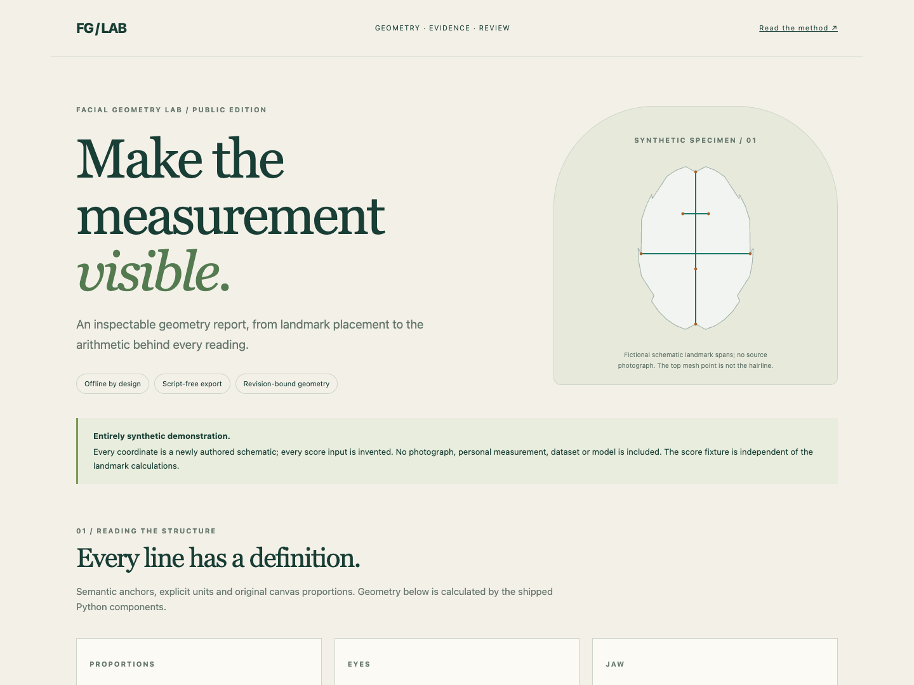

# Facial Geometry Lab

### From facial landmarks to an illustrated, inspectable geometry report.



The original project analyzes facial photographs and presents detailed measurements,
landmark review, and visual reports. This public edition lets you inspect the
measurement and reporting machinery with fictional schematics—without exposing
anyone's photographs or measurements.

**The interesting part:** every line on the diagram has a definition. You can
trace a landmark placement into a measurement, then see how the report handles
missing inputs and how sensitive its summary is to each component.

This public edition exposes the geometry, manual landmark review and report components of the original application. The full photo analyzer, personal calibration, reference banks, model weights and photo collections are intentionally omitted. It is a working component library and synthetic demonstration, not an automatic face-analysis service.

## Run the offline demo

Requires Python 3.10+.

```sh
python -m venv .venv
source .venv/bin/activate
python -m pip install -r requirements.txt
python demo.py
python -m unittest discover -s tests -v
```

Open `docs/demo.html` directly in a browser. It embeds its styles and SVG diagrams and needs no server or external resources. `docs/synthetic-report.json` is the corresponding machine-readable example.

## What actually runs

- Frontal landmark geometry with aspect-ratio preservation, partial readings and explicit definitions.
- Seven-anchor profile geometry with independently available measurements, signed offsets and SVG projection lines.
- Strict coordinate validation, review revision conflicts and measurement-contract hashes.
- Product summary arithmetic, missing-component reweighting and leave-one-input-out score sensitivity.
- Script-free HTML rendering and structured JSON output.

All demo coordinates are newly authored fictional schematics, unrelated to a person or dataset. Score percentiles are independently invented display inputs, not calculated from those coordinates or a reference population. The geometry functions really calculate their readings from the schematic coordinates. No biological inference or calibrated attractiveness claim is made.

## Source map

| Component | Responsibility |
| --- | --- |
| `local_app/landmark_review.py` | Frontal coordinate validation, calculations, revision handling and export |
| `local_app/measurement_registry.py` | Versioned metric definitions and required anchors |
| `local_app/profile_v2.py` | Partial profile measurements and SVG geometry |
| `local_app/product_report.py` | Explicit composite arithmetic and summary markup |
| `local_app/score_audit.py` | Formula contract and sensitivity diagnostics |
| `local_app/contracts.py` | Typed result payload validation |
| `examples/synthetic.py` | Newly authored fictional demo inputs |
| `demo.py` | Offline report assembly |

A function named `public_review` or `public_diagram` limits export fields; it does **not** anonymize a real person's landmarks. If you use these components with your own data, keep resulting measurements and diagrams private. Only the fictional fixtures belong in this repository.

## Project status

Research and demonstration software, not clinically validated. Geometry is not a
measure of a person's worth, health, or character. Built with AI coding assistance,
including Claude Code. Shared as a portfolio snapshot.

## License

Apache-2.0; see `LICENSE` and `NOTICE`. Pydantic retains its own license.
